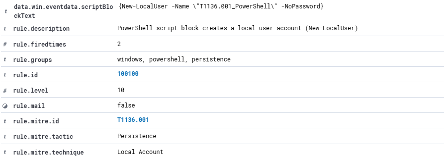
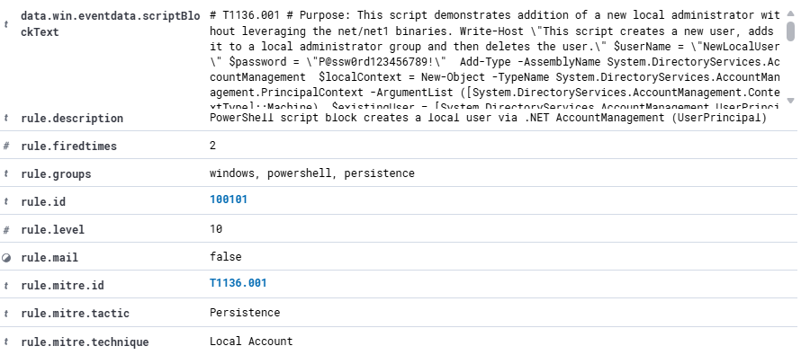
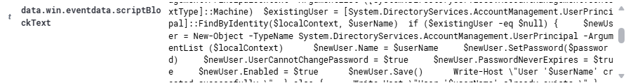
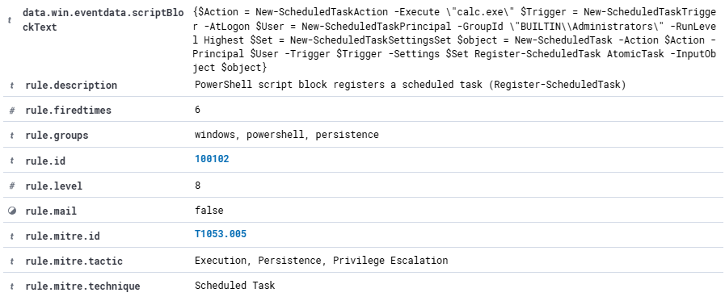
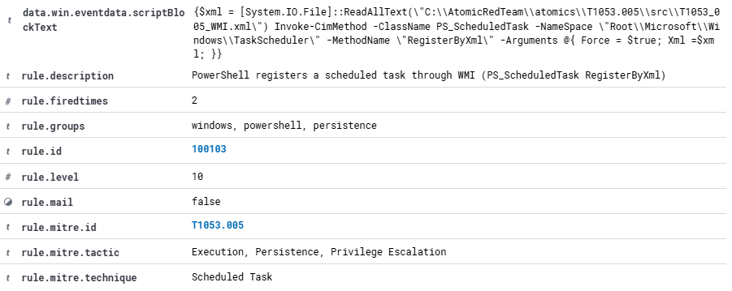

# Custom detection rules

Four custom Wazuh rules. Each one closes a gap found with Atomic Red Team tests, where Wazuh's default rules alerted on the outcome but not on the method. The before and after results are in [`detections.md`](detections.md).

Level markers are the same as in `detections.md`: 🔴 12+ · 🟠 8-11 · 🟡 4-7 · ⚪ 0-3.

## Summary

| Rule | Level | Detects | MITRE | Closes the gap in |
|:---:|:---:|:---|:---:|:---:|
| [100100](#100100-new-localuser) | 🟠 10 | `New-LocalUser` in a PowerShell script block | T1136.001 | T1136.001-5 |
| [100101](#100101-net-accountmanagement) | 🟠 10 | Local account creation through .NET `UserPrincipal` | T1136.001 | T1136.001-9 |
| [100102](#100102-register-scheduledtask) | 🟠 8 | `Register-ScheduledTask` in a PowerShell script block | T1053.005 | T1053.005-4 |
| [100103](#100103-wmi-scheduled-task) | 🟠 10 | Scheduled task registration through WMI (`PS_ScheduledTask`, `RegisterByXml`) | T1053.005 | T1053.005-6 |

## How the rules work

- They use PowerShell **script block logging** (Windows Event ID 4104), which records the code PowerShell runs, including code downloaded and run in memory.
- All four are **children of built-in rule 91802**, which handles PowerShell script block events (`<if_sid>91802</if_sid>`). I found it by reading the `if_sid` of a built-in rule that matches these events (91837), using `sudo grep -rn -B3 -A12 'id="91837"' /var/ossec/ruleset/rules/`.
- They match the script text in the field `win.eventdata.scriptBlockText` with regular expressions (`type="pcre2"`).
- To deploy a rule, add it to `/var/ossec/etc/rules/local_rules.xml` on the Wazuh server, validate with `sudo /var/ossec/bin/wazuh-analysisd -t` (no output means valid), and restart with `sudo systemctl restart wazuh-manager`.

---

## 100100: `New-LocalUser`

```xml
<rule id="100100" level="10">
  <if_sid>91802</if_sid>
  <field name="win.eventdata.scriptBlockText" type="pcre2">(?i)New-LocalUser</field>
  <description>PowerShell script block creates a local user account (New-LocalUser)</description>
  <mitre>
    <id>T1136.001</id>
  </mitre>
</rule>
```

- **Logic:** the script block contains `New-LocalUser` (case-insensitive).
- **Level 10:** suspicious, but below the level 12 that built-in rule 92040 uses for `net user`, because an administrator may legitimately run this cmdlet.
- **Limits:** matches the literal string only. An obfuscated command or another way to create an account would not match, and a legitimate admin script would trigger it.

 

---

## 100101: .NET AccountManagement

```xml
<rule id="100101" level="10">
  <if_sid>91802</if_sid>
  <field name="win.eventdata.scriptBlockText" type="pcre2">(?s)(?=.*System\.DirectoryServices\.AccountManagement)(?=.*UserPrincipal)(?=.*\.Save\(\))</field>
  <description>PowerShell script block creates a local user via .NET AccountManagement (UserPrincipal)</description>
  <mitre>
    <id>T1136.001</id>
  </mitre>
</rule>
```

- **Logic:** the script block contains all three of `System.DirectoryServices.AccountManagement`, `UserPrincipal` and `.Save()`. The `(?s)` flag lets the pattern span lines, and the lookaheads `(?=...)` make the order irrelevant.
- **Why three strings:** one string alone would be too noisy, so the rule requires the library, the object type and the save call together.
- **Limits:** it only recognizes this library. Account creation through ADSI or other APIs would not match, and legitimate admin scripts that use the library could trigger it.





---

## 100102: `Register-ScheduledTask`

```xml
<rule id="100102" level="8">
  <if_sid>91802</if_sid>
  <field name="win.eventdata.scriptBlockText" type="pcre2">(?is)^(?!.*__cmdletization)(?=.*\bRegister-ScheduledTask\b)</field>
  <description>PowerShell script block registers a scheduled task (Register-ScheduledTask)</description>
  <mitre>
    <id>T1053.005</id>
  </mitre>
</rule>
```

- **Logic:** the script block contains the whole word `Register-ScheduledTask`, and does **not** contain `__cmdletization`.
- **Why the exclusion:** the first time the ScheduledTask module loads, PowerShell logs the module's own auto-generated code, which contains the cmdlet names. Without the exclusion, an administrator merely loading the module could trigger the rule.
- **Level 8:** lower than the others, because administrators use this cmdlet regularly.
- **False-positive check:** running `Get-ScheduledTask` in a new PowerShell session produced no new 100102 alerts (count 2 before and after).
- **Limits:** legitimate scheduled task registration will trigger it, so in a real environment it would need exclusions for known admin hosts or accounts.
- **Evasion:** the `__cmdletization` exclusion means an attacker who includes that string in a script block would avoid the rule. A stricter approach would exclude only the module's exact generated code.

 

---

## 100103: WMI scheduled task

```xml
<rule id="100103" level="10">
  <if_sid>91802</if_sid>
  <field name="win.eventdata.scriptBlockText" type="pcre2">(?is)(?=.*Invoke-CimMethod)(?=.*PS_ScheduledTask)(?=.*RegisterByXml)</field>
  <description>PowerShell registers a scheduled task through WMI (PS_ScheduledTask RegisterByXml)</description>
  <mitre>
    <id>T1053.005</id>
  </mitre>
</rule>
```

- **Logic:** the script block contains `Invoke-CimMethod`, `PS_ScheduledTask` and `RegisterByXml` together.
- **Level 10:** creating a task through the WMI class directly is unusual in normal administration.
- **Limits:** other WMI methods of registering a task, or a command split across several script blocks, would not match.



---

## Testing a rule

1. Deploy the rule as described above.
2. Run the matching Atomic Red Team test and search the dashboard for the rule ID, or check the server log: `sudo grep '"id":"100100"' /var/ossec/logs/alerts/alerts.json`.

The dashboard's Ruleset Test is not enough on its own. It decodes pasted JSON with the generic `json` decoder, so a rule can pass it and still fail on real agent events. An early version of rule 100100 did exactly that: it matched the sample but never fired on real events, because it was not a child of the built-in PowerShell script block rule (91802).
