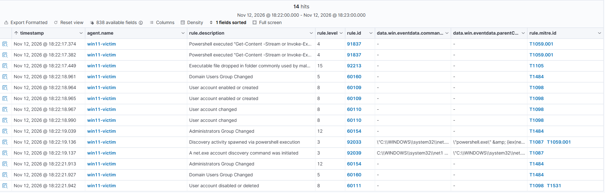
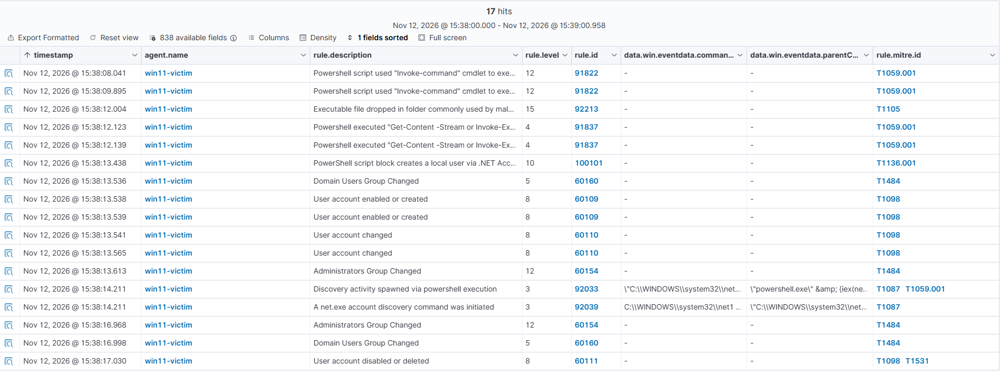
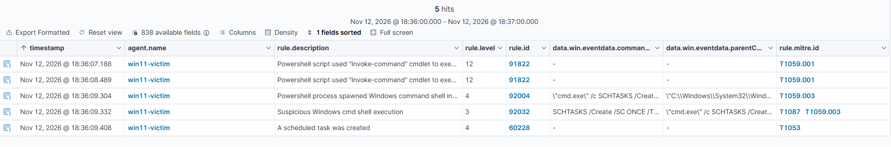
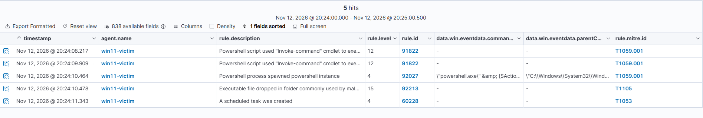
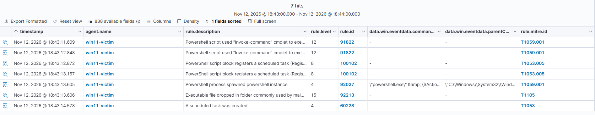
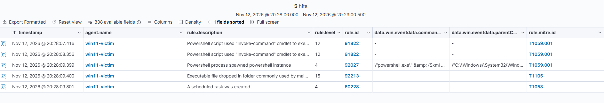
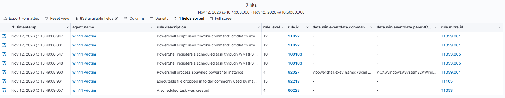

# 📋 Detection results

Seven Atomic Red Team tests on a Windows 11 endpoint (Sysmon, PowerShell script block logging, Wazuh agent), covering two MITRE ATT&CK techniques. Rule IDs, levels and MITRE tags are as shown in the Wazuh dashboard. The custom rules are in [`rules/local_rules.xml`](rules/local_rules.xml).

## How to read this page

- **Status:** ✅ Detected means an alert identified the technique or method itself (the command, or the script). ⚠️ Partially means only the outcome was alerted (for example, "account created"), with no alert showing how.
- **Level:** Wazuh rule level (0-15). Levels 3-4 are low severity and typically not triaged in a real SOC.
- **Level markers:** 🔴 12+ · 🟠 8-11 · 🟡 4-7 · ⚪ 0-3
- **Tables:** the main alert of a run is in **bold**.
- **Screenshots:** taken from the Wazuh dashboard, sorted oldest first. Timestamps are in the dashboard's local time (UTC+2).
- **Layout:** every test lists the command and status, then the alerts and a screenshot, then notes. Tests with a custom rule show a "without" and a "with" run.

## Summary

| Test | Technique | Method | Without custom rule | With custom rule |
|:---:|:---:|:---:|:---:|:---:|
| [T1136.001-4](#t1136-001-4) | Create Account | `net user` (cmd) | ✅ Detected | n/a |
| [T1136.001-5](#t1136-001-5) | Create Account | PowerShell `New-LocalUser` | ⚠️ Partially | ✅ Detected (100100) |
| [T1136.001-8](#t1136-001-8) | Create Account | Admin via `net user` | ✅ Detected | n/a |
| [T1136.001-9](#t1136-001-9) | Create Account | .NET AccountManagement | ⚠️ Partially | ✅ Detected (100101) |
| [T1053.005-2](#t1053-005-2) | Scheduled Task | `schtasks` | ✅ Detected (low severity) | n/a |
| [T1053.005-4](#t1053-005-4) | Scheduled Task | `Register-ScheduledTask` | ⚠️ Partially | ✅ Detected (100102) |
| [T1053.005-6](#t1053-005-6) | Scheduled Task | WMI `RegisterByXml` | ⚠️ Partially | ✅ Detected (100103) |

---

## Technique T1136.001: Create Account

### ❗ T1136.001-4: `net user` in a command prompt

- **Command:** `net user /add "T1136.001_CMD" "T1136.001_CMD!"`
- **Status:** ✅ Detected at process level and in the Windows Security log
- **Main alert:** 🔴 92040, net1.exe executed a user creation command (level 12, T1136.001)

#### Alerts

| Rule | Level | Description | MITRE |
|:---:|:---:|:---|:---:|
| 92052 | 🟡 4 | Windows command prompt started by an abnormal process | T1059.003 |
| 92036 | ⚪ 3 | net.exe binary started by a Windows cmd shell | T1059.003, T1574.001 |
| **92040** | 🔴 **12** | **net1.exe executed a user creation command** | **T1136.001** |
| 60160 | 🟡 5 | Domain Users Group Changed | T1484 |
| 60109 (fires twice) | 🟠 8 | User account enabled or created | T1098 |
| 60110 | 🟠 8 | User account changed | T1098 |
| 60170 | 🟡 5 | Users Group Changed | T1484 |

#### Notes
- Wazuh tagged the account changes as T1098 (Account Manipulation), not T1136.001.
- 91822 (level 12, T1059.001) fired twice at the start of this run, shortly before the attack alerts. Its `scriptBlockText` is the Atomic Red Team framework's own `Invoke-ExecuteCommand` function, which launches the test command, and is not part of the attack. It appeared in most runs but not all (it was absent in test 8), and I did not determine why. It is a false positive caused by the test harness, but it also shows that a red-team framework running on a host leaves a visible trace in PowerShell logs.

---

### ❗ T1136.001-5: PowerShell `New-LocalUser`

- **Command:** `New-LocalUser -Name "T1136.001_PowerShell" -NoPassword` (Event ID 4104)
- **Status:** ⚠️ Partially detected without the custom rule (only the outcome was alerted), ✅ detected with rule 100100

#### Without custom rule

Only the account and group changes were alerted. No alert showed the `New-LocalUser` command.

| Rule | Level | Description | MITRE |
|:---:|:---:|:---|:---:|
| 92027 | 🟡 4 | PowerShell process spawned PowerShell instance | T1059.001 |
| 60160 | 🟡 5 | Domain Users Group Changed | T1484 |
| 60109 (fires twice) | 🟠 8 | User account enabled or created | T1098 |
| 60110 | 🟠 8 | User account changed | T1098 |

#### With custom rule

Custom rule 100100 adds an alert that identifies the method.

| Rule | Level | Description | MITRE |
|:---:|:---:|:---|:---:|
| **100100 (fires twice)** | 🟠 **10** | **PowerShell script block creates a local user account (New-LocalUser)** | **T1136.001** |

The other alerts are the same as above.

#### Notes
- 100100 fires twice because Windows logs the script block twice (once bare, once wrapped in `& { }`).
- 91822 (level 12, T1059.001) fired twice at the start of the run. Its `scriptBlockText` is the Atomic Red Team framework's own `Invoke-ExecuteCommand` function, not part of the attack. It appeared in most runs but not all, and I did not determine why. It is a false positive from the test harness.
- 92213 (level 15, T1105) fires on PowerShell's temporary `__PSScriptPolicyTest` file and is a confirmed false positive.

---

### ❗ T1136.001-8: Admin account via `net user`

- **Commands:** `net user /add "T1136.001_Admin" "T1136_pass"`, followed by `net localgroup administrators "T1136.001_Admin" /add`
- **Status:** ✅ Detected at process level and in the Windows Security log
- **Main alerts:** 🔴 92040, net1.exe executed a user creation command (level 12, T1136.001); 🔴 60154, Administrators Group Changed (level 12, T1484)

#### Alerts

| Rule | Level | Description | MITRE |
|:---:|:---:|:---|:---:|
| 92052 | 🟡 4 | Windows command prompt started by an abnormal process | T1059.003 |
| 92036 (first) | ⚪ 3 | net.exe started by a cmd shell (`net user /add`) | T1059.003, T1574.001 |
| **92040** | 🔴 **12** | **net1.exe executed a user creation command** | **T1136.001** |
| 92036 (second) | ⚪ 3 | net.exe started by a cmd shell (`net localgroup administrators`) | T1059.003, T1574.001 |
| 92031 | ⚪ 3 | Discovery activity executed | T1087 |
| 60160 | 🟡 5 | Domain Users Group Changed | T1484 |
| 60109 (fires twice) | 🟠 8 | User account enabled or created | T1098 |
| 60110 | 🟠 8 | User account changed | T1098 |
| 60170 | 🟡 5 | Users Group Changed | T1484 |
| **60154** | 🔴 **12** | **Administrators Group Changed** | **T1484** |

#### Notes
- Unlike test 4, this test also adds the account to the Administrators group. Wazuh responds with a second level 12 alert (60154), so the privilege change is rated as seriously as the account creation.
- 92031 tags the `net localgroup administrators` command as discovery (T1087), although the command adds a member. The tag is a loose fit.
- The process-level alerts (92052, 92036, 92040) come about half a second before the Windows Security alerts (60160 to 60154).
- 91822 did not appear in this run, although it did in tests 4 and 5.

---

### ❗ T1136.001-9: Admin account via .NET

- **Method:** a download cradle (`iex(new-object net.webclient).downloadstring(...)`) fetches a script that creates the account with `System.DirectoryServices.AccountManagement` and adds it to Administrators, without using `net`. The script removes and deletes the account itself about 3-4 seconds later.
- **Status:** ⚠️ Partially detected without the custom rule (the outcome and the `iex` call were alerted, but nothing identified how the account was created), ✅ detected with rule 100101

#### Without custom rule

The account and group changes were alerted, including a level 12 alert for the Administrators group, and the `iex` call was flagged at level 4. No alert identified the .NET account creation.

| Rule | Level | Description | MITRE |
|:---:|:---:|:---|:---:|
| 91837 (fires twice) | 🟡 4 | PowerShell executed "Get-Content -Stream or Invoke-Expresion". Possible string execution as code | T1059.001 |
| 60160 (fires twice) | 🟡 5 | Domain Users Group Changed | T1484 |
| 60109 (fires twice) | 🟠 8 | User account enabled or created | T1098 |
| 60110 (fires twice) | 🟠 8 | User account changed | T1098 |
| 60154 (fires twice) | 🔴 12 | Administrators Group Changed (account added, then removed) | T1484 |
| 92033 | ⚪ 3 | Discovery activity spawned via PowerShell execution | T1087, T1059.001 |
| 92039 | ⚪ 3 | A net.exe account discovery command was initiated | T1087 |
| 60111 | 🟠 8 | User account disabled or deleted | T1098, T1531 |

#### With custom rule

Custom rule 100101 identifies the account creation method inside the downloaded script.

| Rule | Level | Description | MITRE |
|:---:|:---:|:---|:---:|
| **100101** | 🟠 **10** | **PowerShell script block creates a local user via .NET AccountManagement (UserPrincipal)** | **T1136.001** |

The other alerts are the same as above.

#### Notes
- The test needs internet access, because the script is downloaded from GitHub at run time.
- 91822 (level 12, T1059.001) and 92213 (level 15, T1105) appear as in the other PowerShell tests and are false positives from the test harness. 91822 is intermittent: it was present in some runs of this test and absent in others, and I did not determine why.
- 92033 and 92039 come from the script checking the new account with `net user NewLocalUser`.
- A detailed analysis of this attack is in the [incident report](incident-reports/).

---

## Technique T1053.005: Scheduled Task

### ❗ T1053.005-2: Scheduled task via `schtasks`

- **Command:** `SCHTASKS /Create /SC ONCE /TN spawn /TR C:\windows\system32\cmd.exe /ST 20:10`
- **Status:** ✅ Detected, but only at low severity (levels 3-4)
- **Main alert:** 🟡 60228, A scheduled task was created (level 4, T1053), Windows event 4698

#### Alerts

| Rule | Level | Description | MITRE |
|:---:|:---:|:---|:---:|
| 92004 | 🟡 4 | PowerShell process spawned Windows command shell instance | T1059.003 |
| 92032 | ⚪ 3 | Suspicious Windows cmd shell execution (contains the `schtasks` command line) | T1087, T1059.003 |
| **60228** | 🟡 **4** | **A scheduled task was created** | **T1053** |

#### Notes
- The `schtasks` command line is visible in the 92032 alert, so the method is identifiable, unlike the PowerShell and WMI variants (tests 4 and 6).
- Wazuh tags 60228 with the parent technique T1053, not T1053.005, and 92032 with T1087 (Account Discovery), which is a loose fit for creating a task.
- Level 4 for creating a task that launches a command shell is low: most SOCs would not triage it.
- 91822 (level 12) fired twice at the start of the run. It is the Atomic Red Team framework's own code and a false positive from the test harness.

---

### ❗ T1053.005-4: Scheduled task via `Register-ScheduledTask`

- **Command:** `Register-ScheduledTask AtomicTask -InputObject $object`, after building the task with `New-ScheduledTaskAction`, `New-ScheduledTaskTrigger` and `New-ScheduledTaskPrincipal` (a task launching `calc.exe` at logon as the Administrators group with the highest privileges)
- **Status:** ⚠️ Partially detected without the custom rule (only the task creation outcome, at level 4), ✅ detected with rule 100102

#### Without custom rule

The task creation was recorded by Windows (event 4698) at level 4, but no alert showed the PowerShell command that created it.

| Rule | Level | Description | MITRE |
|:---:|:---:|:---|:---:|
| 92027 | 🟡 4 | PowerShell process spawned PowerShell instance | T1059.001 |
| 60228 | 🟡 4 | A scheduled task was created | T1053 |

#### With custom rule

Custom rule 100102 identifies the PowerShell cmdlet that registers the task.

| Rule | Level | Description | MITRE |
|:---:|:---:|:---|:---:|
| **100102 (fires twice)** | 🟠 **8** | **PowerShell script block registers a scheduled task (Register-ScheduledTask)** | **T1053.005** |

The other alerts are the same as above.

#### Notes
- 100102 fires twice because Windows logs the script block twice.
- 100102 excludes script blocks containing `__cmdletization`, because the ScheduledTask module's own generated code contains the cmdlet names. False-positive check: running `Get-ScheduledTask` in a new PowerShell session produced no new 100102 alerts (count 2 before and after).
- 91822 (level 12) and 92213 (level 15, T1105) are false positives from the test harness. 91822 is intermittent and I did not determine why.
- Wazuh tags 60228 with the parent technique T1053, while 100102 uses the specific T1053.005.

---

### ❗ T1053.005-6: Scheduled task via WMI

- **Command:** `Invoke-CimMethod -ClassName PS_ScheduledTask -NameSpace "Root\Microsoft\Windows\TaskScheduler" -MethodName "RegisterByXml" ...`, loading the task definition from an XML file (a task launching `notepad.exe` after user login)
- **Status:** ⚠️ Partially detected without the custom rule (only the task creation outcome, at level 4), ✅ detected with rule 100103

#### Without custom rule

The task creation was recorded by Windows (event 4698) at level 4, with the same alert pattern as test 4, so the two methods could not be told apart from the alerts.

| Rule | Level | Description | MITRE |
|:---:|:---:|:---|:---:|
| 92027 | 🟡 4 | PowerShell process spawned PowerShell instance | T1059.001 |
| 60228 | 🟡 4 | A scheduled task was created | T1053 |

#### With custom rule

Custom rule 100103 identifies the scheduled task registration through the WMI class.

| Rule | Level | Description | MITRE |
|:---:|:---:|:---|:---:|
| **100103 (fires twice)** | 🟠 **10** | **PowerShell registers a scheduled task through WMI (PS_ScheduledTask RegisterByXml)** | **T1053.005** |

The other alerts are the same as above.

#### Notes
- 100103 requires `Invoke-CimMethod`, `PS_ScheduledTask` and `RegisterByXml` together in one script block, so it does not fire on ordinary scheduled task queries.
- The test reads its task definition from an XML file (`T1053_005_WMI.xml`), which the Atomic framework downloads as a prerequisite.
- 91822 (level 12) and 92213 (level 15, T1105) are false positives from the test harness. 91822 is intermittent and I did not determine why.
- Wazuh tags 60228 with the parent technique T1053, while 100103 uses the specific T1053.005.

---

## Cross-cutting findings

- **Outcome vs method:** Wazuh's default rules recorded account and task creation from the Windows Security log, but only identified the method for `net` and `schtasks`. The PowerShell, .NET and WMI methods needed custom rules (100100 to 100103).
- **Severity:** scheduled task creation (60228) was alerted at level 4, and the `schtasks` command (92032) at level 3, which most SOCs would not triage. In contrast, a change to the Administrators group (60154) was rated level 12.
- **Framework noise:** two false positives came from the test harness. 92213 (level 15, PowerShell's execution-policy temp file) fired in all four tests that run through the PowerShell executor (T1136.001-5 and -9, T1053.005-4 and -6) and in none of the three that run through the command prompt. 91822 (level 12, the framework's own code) fired in most runs but not all (it was absent in T1136.001-8 and in some runs of T1136.001-9), and I did not determine why. Both are high severity, which in a real SOC would waste analyst time until tuned.
- **MITRE tags:** several built-in tags are a loose fit: T1098 for account creation, T1484 for local group changes, T1053 instead of T1053.005 for scheduled tasks, and T1087 on the `net localgroup` and `schtasks` alerts.
