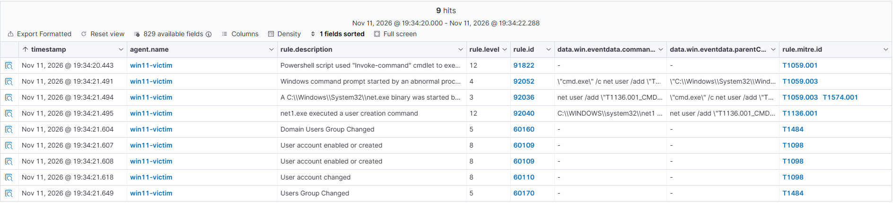
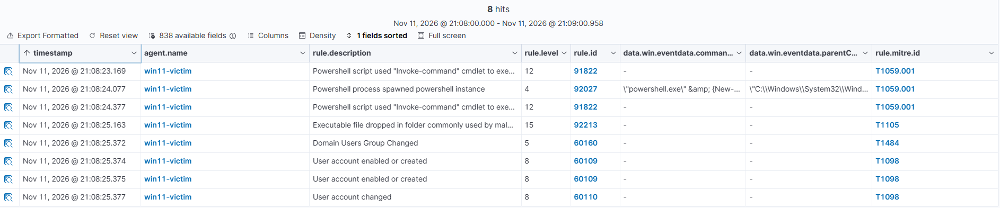
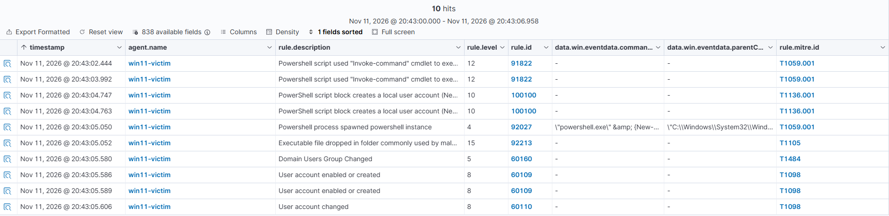
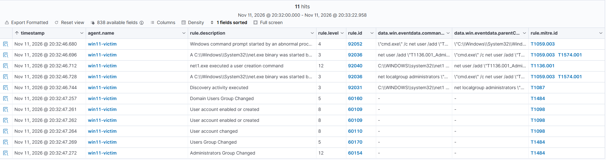

# Detection results

Seven Atomic Red Team tests on a Windows 11 endpoint (Sysmon, PowerShell script block logging, Wazuh agent), covering two MITRE ATT&CK techniques. Rule IDs, levels and MITRE tags are as shown in the Wazuh dashboard.

## Legend

- **Detected:** an alert identified the technique or method itself (the command, or the script).
- **Partially:** only the outcome was alerted (for example, "account created"), with no alert showing how.
- **Level:** Wazuh rule level (0-15). Levels 3-4 are low severity and typically not triaged in a real SOC.
- **Level markers:** 🔴 12+ · 🟠 8-11 · 🟡 4-7 · ⚪ 0-3

## Summary

| Test | Technique | Method | Before custom rules | After custom rules |
|:---:|:---:|:---:|:---:|:---:|
| T1136.001-4 | Create Account | `net user` (cmd) | Detected | n/a |
| T1136.001-5 | Create Account | PowerShell `New-LocalUser` | Partially | Detected (100100) |
| T1136.001-8 | Create Account | Admin via `net user` | Detected | n/a |
| T1136.001-9 | Create Account | .NET AccountManagement | Partially | Detected (100101) |
| T1053.005-2 | Scheduled Task | `schtasks` | Detected (low severity) | n/a |
| T1053.005-4 | Scheduled Task | `Register-ScheduledTask` | Partially | Detected (100102) |
| T1053.005-6 | Scheduled Task | WMI `RegisterByXml` | Partially | Detected (100103) |

## Details

### T1136.001-4: Create a new user in a command prompt
- **Command:** `net user /add "T1136.001_CMD" "T1136.001_CMD!"`
- **Main alert:** 🔴 92040 net1.exe executed a user creation command (level 12, T1136.001)
- **Supporting alerts:**

| Rule | Level | Description | MITRE |
|:---:|:---:|:---|:---:|
| 92052 | 🟡 4 | Windows command prompt started by an abnormal process | T1059.003 |
| 92036 | ⚪ 3 | net.exe binary started by a Windows cmd shell | T1059.003, T1574.001 |
| 60160 | 🟡 5 | Domain Users Group Changed | T1484 |
| 60109 (fires twice) | 🟠 8 | User account enabled or created | T1098 |
| 60110 | 🟠 8 | User account changed | T1098 |
| 60170 | 🟡 5 | Users Group Changed | T1484 |

- **Result:** Detected at process level and in the Windows Security log.

**Notes**
- Wazuh tagged the account changes as T1098 (Account Manipulation), not T1136.001.
- 91822 (level 12, T1059.001) fired twice at the start of this run, shortly before the attack alerts. Its `scriptBlockText` is the Atomic Red Team framework's own `Invoke-ExecuteCommand` function, which launches the test command, not part of the attack. It appeared again at the start of test 5 (a new PowerShell window), but not during test 8 (run in the same window as test 4), so it appears to be logged when the framework is first used in a PowerShell session. This is a false positive caused by the test harness, but it also shows that a red-team framework running on a host leaves a visible trace in PowerShell logs.

   

### T1136.001-5: Create a new user in PowerShell
- **Command:** `New-LocalUser -Name "T1136.001_PowerShell" -NoPassword` (Event ID 4104)
- **Result:** Partially detected without the custom rule (only the outcome was alerted); detected with it.

#### Without custom rule

Only the account and group changes were alerted. No alert showed the `New-LocalUser` command.

| Rule | Level | Description | MITRE |
|:---:|:---:|:---|:---:|
| 92027 | 🟡 4 | PowerShell process spawned PowerShell instance | T1059.001 |
| 60160 | 🟡 5 | Domain Users Group Changed | T1484 |
| 60109 (fires twice) | 🟠 8 | User account enabled or created | T1098 |
| 60110 | 🟠 8 | User account changed | T1098 |

#### With custom rule

Custom rule 100100 adds an alert that identifies the method.

| Rule | Level | Description | MITRE |
|:---:|:---:|:---|:---:|
| 100100 (fires twice) | 🟠 10 | PowerShell script block creates a local user account (New-LocalUser) | T1136.001 |

The other alerts are the same as above.

#### Notes
- 100100 fires twice because Windows logs the script block twice (once bare, once wrapped in `& { }`).
- 91822 (level 12, T1059.001) fired twice at the start of the run, in a new PowerShell window. Its `scriptBlockText` is the Atomic Red Team framework's own `Invoke-ExecuteCommand` function, not part of the attack. It appears to be logged when the framework is first used in a session: it did not appear during test 8, which ran in the same window as test 4. This is a false positive from the test harness.
- 92213 (level 15, T1105) fires on PowerShell's temporary `__PSScriptPolicyTest` file and is a confirmed false positive.

### T1136.001-8: Create a new Windows admin user

- **Commands:** `net user /add "T1136.001_Admin" "T1136_pass"`, followed by `net localgroup administrators "T1136.001_Admin" /add`
- **Main alerts:** 🔴 92040, net1.exe executed a user creation command (level 12, T1136.001); 🔴 60154, Administrators Group Changed (level 12, T1484)
- **Result:** Detected at process level and in the Windows Security log.

**Supporting alerts**

| Rule | Level | Description | MITRE |
|:---:|:---:|:---|:---:|
| 92052 | 🟡 4 | Windows command prompt started by an abnormal process | T1059.003 |
| 92036 (first) | ⚪ 3 | net.exe started by a cmd shell (`net user /add`) | T1059.003, T1574.001 |
| 92036 (second) | ⚪ 3 | net.exe started by a cmd shell (`net localgroup administrators`) | T1059.003, T1574.001 |
| 92031 | ⚪ 3 | Discovery activity executed | T1087 |
| 60160 | 🟡 5 | Domain Users Group Changed | T1484 |
| 60109 (fires twice) | 🟠 8 | User account enabled or created | T1098 |
| 60110 | 🟠 8 | User account changed | T1098 |
| 60170 | 🟡 5 | Users Group Changed | T1484 |

**Notes**
- Unlike test 4, this test also adds the account to the Administrators group. Wazuh responds with a second level 12 alert (60154), so the privilege change is rated as seriously as the account creation.
- 92031 tags the `net localgroup administrators` command as discovery (T1087), although the command adds a member. The tag is a loose fit.
- The process-level alerts (92052, 92036, 92040) come about half a second before the Windows Security alerts (60160 to 60154).

### T1136.001-9: Create a new Windows admin user via .NET
- **Method:** a download cradle (`iex(new-object net.webclient).downloadstring(...)`) fetches a script that creates the account with `System.DirectoryServices.AccountManagement` and adds it to Administrators, without using `net`.
- **Before:** 60154 (12), 60109 (8), 60110 (8), 60160 (5), 91837 `iex` string execution (4), 92033 and 92039 discovery (3). No alert identified the account creation method.
- **After:** custom rule 100101 (level 10, T1136.001)
- **Notes:** The test needs internet access. See the [incident report](incident-reports/).

### T1053.005-2: Scheduled task, local
- **Command:** `SCHTASKS /Create /SC ONCE /TN spawn /TR C:\windows\system32\cmd.exe /ST 20:10`
- **Main alert:** 60228 A scheduled task was created (level 4, T1053), Windows event 4698
- **Supporting alerts:** 92004 (4), 92032 suspicious cmd shell execution (3), which contains the `schtasks` command line
- **Result:** Detected, but only at levels 3-4.
- **Notes:** Wazuh tags 60228 with the parent technique T1053, not T1053.005.

### T1053.005-4: PowerShell cmdlet scheduled task
- **Command:** `Register-ScheduledTask AtomicTask -InputObject $object` (a task launching `calc.exe` at logon with highest privileges)
- **Before:** 60228 (4), 92027 (4). No alert showed the PowerShell command.
- **After:** custom rule 100102 (level 8, T1053.005)
- **Notes:** 100102 excludes script blocks containing `__cmdletization`, because the ScheduledTask module's own generated code contains the cmdlet names. False-positive check: running `Get-ScheduledTask` in a new session produced no new 100102 alerts (count 2 before and after).

### T1053.005-6: WMI Invoke-CimMethod scheduled task
- **Command:** `Invoke-CimMethod -ClassName PS_ScheduledTask -NameSpace "Root\Microsoft\Windows\TaskScheduler" -MethodName "RegisterByXml" ...`
- **Before:** 60228 (4), 92027 (4). The alert pattern was identical to test 4, so the two methods could not be told apart.
- **After:** custom rule 100103 (level 10, T1053.005)

## Cross-cutting findings
- **Outcome vs method:** Wazuh's default rules recorded account and task creation from the Windows Security log, but only identified the method for `net` and `schtasks`. PowerShell, .NET and WMI methods needed custom rules.
- **Severity:** scheduled task creation was alerted at level 4, which most SOCs would not triage.
- **False positive:** alert 92213 (level 15) fired in every PowerShell-based test because of PowerShell's execution-policy temp file.
- **MITRE tags:** several built-in tags are a loose fit (T1098 for account creation, T1053 instead of T1053.005, T1484 for local group changes).
